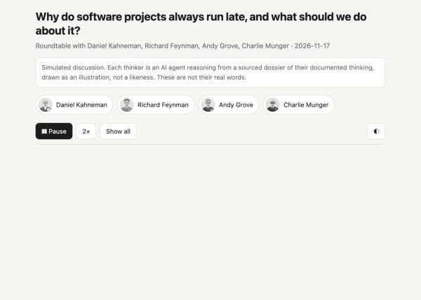
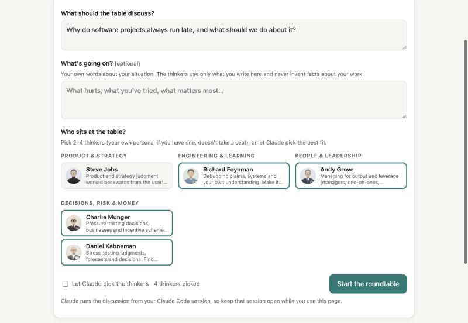
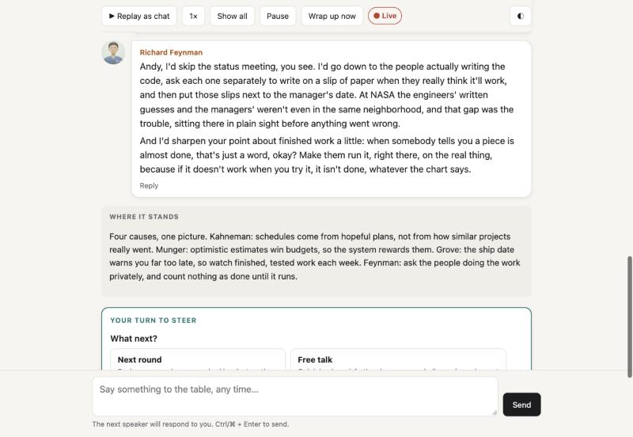

# Ask the Experts

**Put your question to a table of great minds, and take part yourself.**

A Claude Code plugin that runs a live roundtable on any question. Feynman, Kahneman, Andy Grove, Steve Jobs, Charlie Munger, and 13 roles from the security architect to the frustrated end user, each speak in turn, answer each other, look things up when they need a fact, and turn to you with questions. Jump in any time.



## Why it's different

- **Grounded, not cosplay.** Every expert is built from a sourced dossier: their own books, talks and interviews first, then authoritative biographies and major journalism. Each dossier records how they attack a problem, verified short quotes, quotes wrongly attributed to them, and their documented blind spots.
- **They genuinely disagree.** Each expert is a separate AI agent that hears everything said so far and pushes back where their thinking differs. Nobody is smoothed into consensus.
- **You're at the table.** A messenger-style chat: your chats are listed like a messenger, start a direct chat with one expert or a group with several, add people any time, attach images and documents, and type @ to tag who should answer next (including @Claude, the host, to have something looked up). A finished chat picks up again when you write in it. On a desktop the chat list sits on the left and the conversation on the right. Add a persona of *yourself*, built only from files on your computer, to see where your habits differ from theirs.
- **Evidence on demand.** When an expert says "I'd want to know…", a researcher agent finds it and puts sourced facts on the table.
- **Characters, not quote machines.** Each dossier also describes how the person behaves in a room: temperament, how they argue, what they notice, what they care about outside their work. So they talk like people, in short spoken turns, instead of reciting their famous stories. A built-in check sends back any turn that reads like an essay.
- **Your own people, privately.** Create a persona of someone you work with, or a role, from your own description and documents. It stays on your computer, and the builder suggests a nickname or role name instead of a real name.
- **Plain language, no made-up facts.** Experts use everyday words, and use only what you tell them about your situation.
- **Private by default.** It runs on your machine. The app listens on `127.0.0.1` only, and your persona and logs never leave your computer.

## Install

In Claude Code (desktop app or CLI):

```
/plugin marketplace add mgblackwater/ask-the-experts
/plugin install ask-the-experts@ask-the-experts
```

Then run `/ask-the-experts:ask setup`, or just use it, since setup runs the first time. It asks what to call you, where to keep logs, whether to build your own persona, and whether to check the living experts for news.

Requires Python 3 (standard library only) for the local app.

## Use it

| You type | You get |
|---|---|
| `/ask-the-experts:ask app` | The **Ask the Experts** app: start a roundtable, pick experts, watch and join in |
| `/ask-the-experts:ask feynman: why is our build so flaky?` | One expert's way of thinking applied to your problem |
| `/ask-the-experts:ask panel grove,kahneman: should we reorganise?` | Several experts at once, and where they disagree |
| `/ask-the-experts:ask should we rewrite the billing service?` | It suggests the experts best suited to your question |
| `/ask-the-experts:ask build Ada Lovelace` | Researches a public figure and adds them to the table |

Or just say "what would Kahneman think about…" or "let them debate it".

## The experts

It ships with five great minds from history, each with a full sourced dossier:

|  |  |  |  |  |
|:---:|:---:|:---:|:---:|:---:|
| **Richard Feynman**<br>debugging claims and systems, not fooling yourself | **Daniel Kahneman**<br>judgment, forecasts, how plans usually turn out | **Andy Grove**<br>managing for output, spotting turning points | **Steve Jobs**<br>product focus, what to cut, what great looks like | **Charlie Munger**<br>incentives, inverting the problem, avoiding stupidity |

And 13 **roles**: fictional characters, not real people. Each one's way of thinking is grounded in documented professional practice, and their personality is invented, so the table hears from the people who usually aren't in the room:

|  |  |  |  |
|:---:|:---:|:---:|:---:|
| **The Skeptical Security Architect**<br>assumes breach, asks for the blast radius | **The Pragmatic Staff Engineer**<br>boring tech, small reversible steps | **The On-Call SRE**<br>what breaks at 3am, and how to roll back | **The Curious Junior Developer**<br>asks the questions everyone stopped asking |
|  |  |  |  |
| **The Outcome-Driven Product Manager**<br>what problem, for whom, how we'll know | **The Frustrated End User**<br>does it just work? | **The UX Researcher**<br>evidence from real users, not opinions | **The Frontline Clinician**<br>every extra click costs patient time |
|  |  |  |  |
| **The Cost-Conscious CFO**<br>total cost, payback, what we stop doing | **The Compliance Auditor**<br>show me the evidence and who signed it off | **The CEO**<br>owns the whole outcome, decides under uncertainty | **The Battle-Scarred Veteran**<br>has seen every fad twice |
|  |
| **The Devil's Advocate**<br>argues the opposite on purpose |

**Want someone else at the table?** In the app, **Persona** lets you add a well-known public figure (researched from reliable sources) or someone you work with (from your own description). In chat, `/ask-the-experts:ask build <name>` does the same. Your additions, and your own persona, stay in your home folder on your own machine and are never part of the plugin.

Each dossier lives in [`skills/ask/personas/`](plugins/ask-the-experts/skills/ask/personas) and lists its sources.

See a full roundtable: [docs/example-roundtable.html](docs/example-roundtable.html). Download it and open it in a browser to replay it as a chat.

## How a roundtable works

1. You pose the question, optionally describe your situation in your own words, and choose an aim: debate, reach a decision, find the hidden truth, or explore. The aim steers how the table talks and how it ends, and you can change it between rounds.
2. Experts speak one at a time, and whoever would jump in speaks next. Each is a fresh agent that reads only its own dossier plus the conversation so far.
3. After each round you get a card: next round, free talk, or wrap up, plus any questions the experts asked you. You can also just type.
4. When an expert needs a fact, a researcher agent fetches it with sources and posts it for everyone.
5. It ends with each expert's last word and a synthesis shaped by the aim: the answer (or the decision, or what survived the evidence), what changed, what didn't, and what to do next.

Every roundtable is saved as a page you can replay like a chat.

## Screenshots

| Start a roundtable | Join in |
|---|---|
|  |  |

## Privacy and honesty

- **Simulated words.** These are AI simulations grounded in public sources, not the real people's words or views. Every page says so.
- **Not affiliated with or endorsed by** any of the people represented. The avatars are drawn illustrations, not likenesses.
- **Your data stays local.** Settings, your persona and roundtable logs live on your machine (`~/.claude/ask-the-experts/` and your chosen logs folder). Web research sends only generic queries, never your name, employer or project details.
- **Dossiers age.** Living people's views change. Each dossier is dated, and the plugin offers to refresh old ones every few months.

- **Respectful by design.** Requests to make an expert say something hateful, mock someone, "confess" private matters, endorse a product or a candidate, or produce quotes to pass off as real are declined, with an offer of a version that works.

## Contributing

- **Fix a dossier:** open an issue or pull request with a source.
- **Propose an expert:** open an issue. The plugin ships only historical figures. The rules for any dossier are in [`building-a-persona.md`](plugins/ask-the-experts/skills/ask/references/building-a-persona.md): sources ranked by reliability, verified quotes only, and documented criticism included.
- **Represented here?** If you're a relative or estate of someone in this plugin and want changes or removal, open an issue and it will be handled promptly.

## Licence

MIT (see [LICENSE](LICENSE)).
